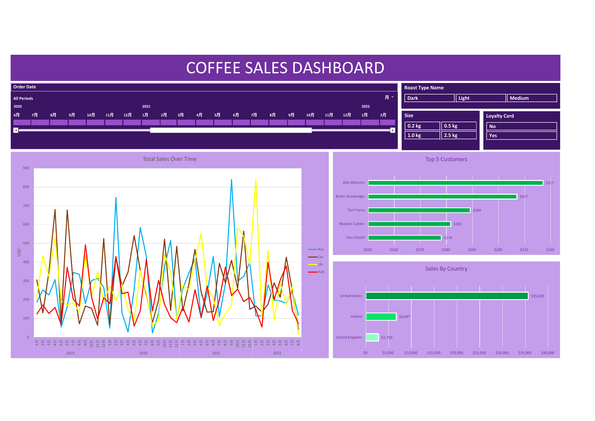

# Coffee Sales Analysis

An end-to-end Excel project that transforms customer and product data into an interactive sales dashboard and a testable growth recommendation.

**Tools:** Excel, XLOOKUP, INDEX/MATCH, Excel Tables, PivotTables, PivotCharts, slicers, and a timeline

## Business problem

How can the company use customer shopping data to identify trends, improve customer engagement, and optimize marketing and product strategies?

The analysis focuses on three decisions:

- Which markets and products drive sales?
- Where are the largest customer engagement gaps?
- Which actions can increase repeat purchases and basket size without sacrificing profit?

## Data and process

The workbook contains 1,000 order line items from January 2019 through August 2022, supported by customer and product tables.

The Excel workflow:

1. Joined customer and product attributes to the order table with XLOOKUP and INDEX/MATCH.
2. Standardized coffee and roast labels and calculated line-level sales.
3. Built PivotTables for sales trends, country performance, and top customers.
4. Added PivotCharts, slicers, and a date timeline to create an interactive dashboard.

## Results

Key findings:

- Total sales were **$45,134** across **957 orders**.
- The United States generated **$35,639**, or about **79% of sales**.
- Excelsa and Liberica led product sales, while Robusta generated the least revenue and has the lowest margin at **6%**.
- Only **25 of 913 purchasing customers** placed more than one order, a **2.7% repeat-customer rate**.
- Only **31 orders** contained multiple products, a **3.2% multi-product basket rate**.
- The top customer generated **$317** in sales, so revenue is not concentrated in a single high-value customer.

### Executive recommendation

Pursue profitable growth through a 90-day U.S. loyalty pilot focused on two behaviors:

1. Convert first-time buyers into second-time buyers.
2. Increase multi-product baskets with personalized, high-margin recommendations.

| Group | Experience |
| --- | --- |
| Control | Current loyalty experience |
| Frequency | Bonus points for another purchase within 30 days |
| Basket | Bonus points for spending at least $60 |
| Combined | Both offers, subject to a profitability limit |

Deliver offers through the loyalty app, website, and point-of-sale system. Use the last purchase to recommend discovery bundles with smaller Liberica or Excelsa products, complementary roasts or varieties, and larger packages when appropriate. Avoid broad Robusta discounts because of its 6% margin.

## Next steps and limitations

Measure second-purchase rate, days to next purchase, average order value, multi-product basket rate, gross profit per order, and promotion cost for each pilot group. Show customers their point balance, distance to the next reward, and offer expiration.

The analysis is descriptive and covers 2019–2022. It does not include campaign exposure, acquisition cost, channel behavior, or fulfillment cost, so the pilot is required to establish causal impact and confirm profitability. Customer contact fields also require appropriate privacy and access controls.

## Project file

- [`coffeeOrdersData.xlsx`](coffeeOrdersData.xlsx) — cleaned data, formulas, PivotTables, PivotCharts, slicers, and the interactive dashboard

